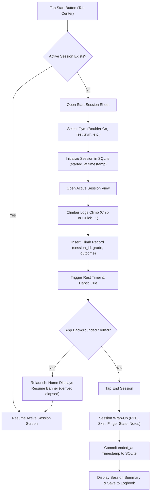
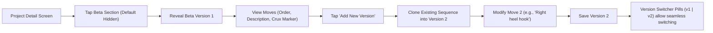
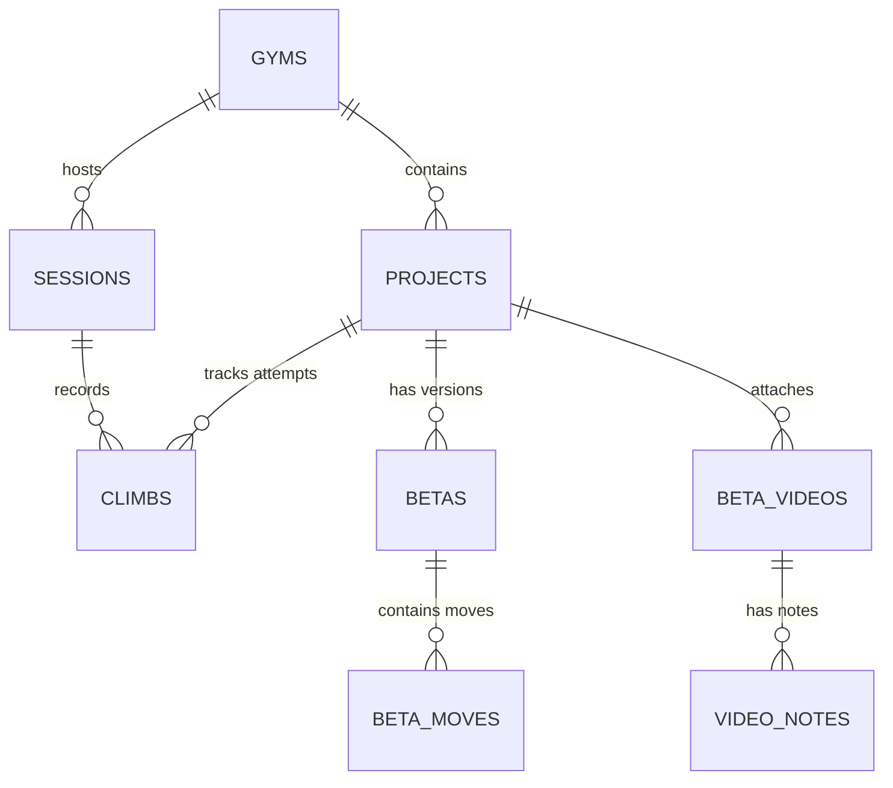

# Gripped — Product Requirements Document (PRD)

**Version:** 1.0 (Production Release Specification)  
**Status:** Final Draft  
**Target Platform:** iOS (Offline-First React Native / Expo)  
**Author / Team:** Gripped Core Engineering & Product  

---

## 1. Executive Summary & Product Vision

### 1.1 Vision
**Gripped** (formerly *CruxLog*) is an iOS-first, offline-first bouldering companion designed for climbers who want to log sessions with zero friction and methodically solve multi-session projects.

Unlike generic fitness trackers, notes apps, or cloud-heavy platforms, Gripped operates with **100% offline autonomy**. Local SQLite is the sole source of truth; zero network calls are required to log, analyze, or organize climbs. The app combines two complementary modes of climbing:
1. **Frictionless Session Logging**: Rapidly captures grades, sends, flashes, and attempts in seconds—even deep in concrete climbing gyms with zero cell service.
2. **Dedicated Project Hub with Versioned Beta**: Provides a structured workbench for multi-week projects, complete with move-by-move beta sequences, crux markers, and a hybrid video library combining local technique clips and social media inspiration.

### 1.2 Core Product Tenets
- **Speed Over Data Entry**: Logging a climb must never disrupt climbing rhythm or chalked hands. Quick +1 attempt taps, presets, and intelligent defaults make logging instant.
- **Local-First & Zero Accounts**: No email, no password, no subscriptions, no cloud sync failure modes. All user data stays on device in private SQLite storage, portable via standard JSON export/import.
- **Versioned Beta Architecture**: Climbing beta evolves across attempts. Gripped preserves previous versions of a problem's beta while letting climbers fork and refine new sequences.
- **Hybrid Video Library**: Combines 60-second native offline video clips for technique analysis with TikTok/Instagram share-sheet link capture for creative inspiration.

---

## 2. Target Personas & Climbing Modes

| Persona | Climbing Profile | Primary Problem Solved in Gripped |
| :--- | :--- | :--- |
| **The Casual Gym Boulderer** | Climbs 2–4 times a week, logs 10–25 problems per session across various walls, rarely works the same boulder twice. | Fast session start, 1-tap logging, rest timer intervals, session summary telemetry, and long-term grade pyramid analytics without tedious project setup. |
| **The Project Grinder** | Dedicates multiple sessions over weeks or months to sending limit boulders (V5–V14+). | Persistent project cards with wall angles, hold types, estimated moves, versioned step-by-step beta sequences, crux flags, burn counters, and attached video proof. |
| **The Visual Beta Hunter** | Discovers alternative sequences and micro-beta on Instagram and TikTok or records friends' attempts on their phone. | 1-tap social share-sheet link saving and 60-second video clip capture, pinned directly to specific beta moves for review right before pulling onto the wall. |

---

## 3. Core Product Pillars

```
┌────────────────────────────────────────────────────────────────────────┐
│                          GRIPPED PRODUCT PILLARS                       │
├─────────────────────────┬───────────────────────┬──────────────────────┤
│  1. FAST SESSION LOG    │  2. PROJECT HUB &     │  3. HYBRID VIDEO     │
│     & TELEMETRY         │     VERSIONED BETA    │     LIBRARY          │
├─────────────────────────┼───────────────────────┼──────────────────────┤
│ • 1-tap quick logging   │ • Target grade & spec │ • 60s native clips   │
│ • Live rest timer       │ • Move-by-move beta   │ • TikTok/IG links    │
│ • Seamless crash resume │ • Crux point tagging  │ • Move-level pinning │
│ • Dual-link to projects │ • Multi-version forks │ • Local cache mgmt   │
│ • Pyramid analytics     │ • Sent celebration   │ • Share beta summary │
└─────────────────────────┴───────────────────────┴──────────────────────┘
```

### Pillar 1: Lightning Fast Offline Session Telemetry
- Start session with optional gym selection (defaults to last used gym).
- Live telemetry bar: total volume, send rate %, flash count, hardest send, and active session duration.
- Grade chips (V-scale / Fontainebleau) with single-tap outcome recording (`Flash`, `Top`, `Attempt`).
- Quick `+1 Attempt` button for rapid repetition logging.
- Background-safe rest timer derived from timestamps with customizable haptic notifications.
- Session wrap-up: perceived exertion (RPE 1–5), skin state (`Good`, `Thin`, `Split`, `Sweaty`), and finger fatigue (`Fresh`, `Tired`, `Sore`, `Tweaked`).

### Pillar 2: Project Hub & Versioned Beta Sequencing
- Projects persist independently across sessions and belong to a specific gym (or Outdoor / Other).
- Projects hold technical specifications: target grade, wall angle (Slab, Vertical, Overhang, Roof), hold types (Crimps, Slopers, Pinches, Jugs, Pockets, Edges), total moves, and high-water mark.
- **Versioned Beta Sequences**:
  - Each beta version contains ordered moves (`1: Start LH crimp`, `2: Right foot smear`, etc.).
  - Move attributes: description, limb tags, and single `CRUX` toggle.
  - Forking creates `Version 2`, `Version 3`, etc., allowing climbers to switch between approaches while preserving earlier iterations.
- **Project Lifecycle**: `Active` → `Sent` → `Archived`.
  - Sending a project triggers an immersive celebration modal (confetti, haptics, send recap) and updates peak grade analytics. Reopening or reactivating is supported.

### Pillar 3: Hybrid Beta Video Library
- **Local Video Clips**:
  - Record natively (up to 60 seconds) or import from camera roll.
  - Trimmed and compressed locally to conserve device storage.
  - Can be pinned to an entire project or tagged to an individual beta move.
- **Social Media Link Inbox**:
  - Receive links shared directly from TikTok or Instagram via the iOS Share Sheet extension.
  - In-app fallback button: "Paste URL / Clipboard" for manual link entry.
  - Captures post URL, caption, thumbnail preview, and source platform.
  - Link inbox acts as an unsorted tray; climbers can attach items to any project or climb with one tap.

---

## 4. Navigation & Information Architecture

The app uses a 4-tab floating glassmorphic navigation bar centered around an elevated action button:

```
┌────────────────────────────────────────────────────────────────────────┐
│                              SCREEN MAP                                │
├────────────────────────────────────────────────────────────────────────┤
│                                                                        │
│   [ HOME ]     [ EXPLORE ]     ( START )     [ PROGRESS ]   [ LOGBOOK ]│
│      │              │              │              │              │     │
│   • Bento Stats  • Gyms List   • Live Session  • Grade Pyramid• History│
│   • Resume Card  • Gym Detail  • Log Sheet     • Send Rates   • Months │
│   • Active Proj  • Video Inbox • Rest Timer    • Performance  • Search │
│   • Streak Strip • Attach Sheet• Wrap-Up (End) • Wall Mastery • Detail │
│                                                                        │
│   [ SETTINGS ] (Header avatar on Home)                                 │
│   • Grade system (V-Scale vs Font) • Rest duration presets             │
│   • Haptics & Celebrations toggle  • Storage manager (SQLite & Cache)  │
│   • Backup export & import (.json) • Privacy & Architecture info       │
└────────────────────────────────────────────────────────────────────────┘
```

### Screen Inventory & Roles

| Screen | Route | Entry Point | Key Functionality |
| :--- | :--- | :--- | :--- |
| **Home** | `app/index.tsx` | Tab 1 | User avatar with Settings trigger, bento stats (sessions/climbs/sends this week), active session resume banner or next objective project card, 4-week streak strip, recent sessions preview. |
| **Explore** | `app/explore.tsx` | Tab 2 | Gyms list, Add Gym modal, Gyms / Video Inbox switcher, unsorted social link library, quick attach sheet. |
| **Gym Detail** | `app/gym/[id].tsx` | Explore | Gym projects grouped by status (`Active`, `Sent`, `Archived`), Gym session history, Add Project button. |
| **Start / Active** | `app/session/active.tsx` | Tab Center | Live session telemetry, grade chips, `+1 Attempt` button, rest timer capsule, session pyramid and curve, dual-linking to projects. |
| **Log Sheet** | Modal / Sheet | Active Session | Detailed climb entry modal: grade selection, outcome chips (`Flash`, `Top`, `Attempt`), burn counter, notes, project association. |
| **Session Wrap-Up**| `app/session/end.tsx` | Active Session | End session summary, perceived exertion (RPE 1–5), skin and finger condition tags, optional photos, session notes. |
| **Session Summary**| `app/session/summary.tsx`| Wrap-Up | Post-session celebratory recap card showing climbs, sends, hardest grade, and personal best milestones. |
| **Projects** | `app/projects.tsx` | Home link / Gym | Project management hub: Active, Sent, and Archived lists, high-water mark badges, sort & filter controls. |
| **Project Detail** | `app/project/[id].tsx` | Projects / Home | Project specifications, high-water mark, versioned beta builder, crux indicator, attached local video clips, linked social posts, burn history. |
| **Progress** | `app/analytics.tsx` | Tab 3 | Grade pyramid bars (interactive drill-down to matching climbs), 7d / 30d / 90d / 1y / All-Time filters, flash efficiency %, hardest send, wall angle proficiency radar. |
| **Logbook** | `app/profile.tsx` | Tab 4 | Chronological session list grouped by month, search and filter modal, session cards showing volume, sends, gym, and duration. |
| **Session Detail** | `app/session/detail/[id].tsx`| Logbook | Retrospective view of all climbs in a past session, edit/delete climb actions, promote climb to project, edit session notes. |
| **Settings** | `app/settings.tsx` | Home Header | Grade scale preference, rest presets, haptic switches, storage usage breakdown, JSON backup export and import. |

---

## 5. End-to-End User Flows & System Connections

### Flow 1: Live Session Logging & Background Resume


### Flow 2: Project Dual-Linking & Promotion
- **Promoting a climb to a project**:
  1. From an active session or a past session in the Logbook, climber taps **"Make Project"** on a climb card.
  2. Project creation sheet opens pre-populated with:
     - Gym name (inherited from session).
     - Grade (raw string and normalized index).
     - Initial attempts count (inherited from climb).
  3. Saving creates an `Active` project in SQLite and updates the climb's `project_id`.
- **Working an existing project in a session**:
  1. During an active session, the active gym's projects are displayed as quick-action project cards.
  2. Tapping a project card logs a burn directly against that project.
  3. Every burn logged against a project writes a standard climb row linked to the current `session_id` AND increments the project's `total_burns`.
  4. If the climb is marked as `Top`:
     - If burns == 1 and no prior attempts exist, user can claim `Flash`.
     - App prompts: *"Mark project as Sent?"*.
     - Confirming transitions project status to `sent`, records `completed_at`, fires the celebration engine, and recalculates peak grade.

### Flow 3: Move-by-Move Versioned Beta Sequencing

- Moves are ordered incrementally (`move_order: 1, 2, 3...`).
- Crux toggle sets `is_crux = 1` for a single move in that sequence.
- Crux marker is displayed prominently with accent styling and a `CRUX` badge.
- When sharing a beta via iOS share sheet, Gripped compiles a human-readable text card containing key tips, move sequences, crux flags, and external video URLs.

### Flow 4: Hybrid Video Library (Local Clips & Social Links)

```mermaid
flowchart TD
    subgraph Local Clips
        L1["Tap Record / Import Video"] --> L2["Enforce 60s Max Duration"]
        L2 --> L3["Compress & Save to documentDirectory"]
        L3 --> L4["Insert SQLite Row into beta_videos"]
        L4 --> L5["Pin to Beta Version or Specific Move"]
    end
    subgraph Social Links
        S1["Share Sheet from TikTok / Instagram OR Paste URL"] --> S2["Extract URL & Platform Metadata"]
        S2 --> S3["Cache Preview Thumbnail Locally"]
        S3 --> S4["Save to Unsorted Video Inbox in Explore"]
        S4 --> S5["Tap 'Attach' to Link with Project"]
    end
```


---

## 6. Data Model & Database Schema

All data resides in local SQLite (`cruxlog_v2.db`). The schema enforces foreign key integrity while preserving historical climbing logs through cascade protections.

### Entity Relationship Diagram


### Table Definitions

#### `sessions`
```sql
CREATE TABLE IF NOT EXISTS sessions (
  id TEXT PRIMARY KEY,
  user_id TEXT,
  gym_id TEXT REFERENCES gyms(id) ON DELETE SET NULL,
  gym_name TEXT NOT NULL DEFAULT '',
  started_at INTEGER NOT NULL,
  ended_at INTEGER,
  effort INTEGER,
  notes TEXT NOT NULL DEFAULT '',
  title TEXT NOT NULL DEFAULT '',
  rpe INTEGER,
  skin_state TEXT,
  finger_fatigue TEXT,
  media_uris TEXT,
  created_at INTEGER NOT NULL,
  updated_at INTEGER NOT NULL,
  deleted_at INTEGER,
  server_updated_at INTEGER,
  sync_status TEXT NOT NULL DEFAULT 'pending'
);
```

#### `climbs`
```sql
CREATE TABLE IF NOT EXISTS climbs (
  id TEXT PRIMARY KEY,
  session_id TEXT NOT NULL REFERENCES sessions(id) ON DELETE CASCADE,
  project_id TEXT REFERENCES projects(id) ON DELETE SET NULL,
  grade_raw TEXT NOT NULL,
  grade_system TEXT NOT NULL DEFAULT 'v_scale',
  grade_index INTEGER NOT NULL,
  outcome TEXT NOT NULL, -- 'flash', 'top', 'attempt'
  attempts INTEGER NOT NULL DEFAULT 1,
  angle TEXT,
  notes TEXT NOT NULL DEFAULT '',
  photo_uri TEXT,
  created_at INTEGER NOT NULL,
  updated_at INTEGER NOT NULL,
  deleted_at INTEGER,
  server_updated_at INTEGER,
  sync_status TEXT NOT NULL DEFAULT 'pending'
);
```

#### `projects`
```sql
CREATE TABLE IF NOT EXISTS projects (
  id TEXT PRIMARY KEY,
  user_id TEXT,
  gym_id TEXT REFERENCES gyms(id) ON DELETE SET NULL,
  gym_name TEXT,
  title TEXT NOT NULL,
  grade_raw TEXT NOT NULL,
  grade_system TEXT NOT NULL DEFAULT 'v_scale',
  grade_index INTEGER NOT NULL,
  wall_angle TEXT NOT NULL, -- 'slab', 'vertical', 'overhang', 'roof'
  hold_type TEXT NOT NULL,   -- 'crimps', 'slopers', 'pinches', 'jugs', 'pockets', 'edges'
  status TEXT NOT NULL DEFAULT 'in_progress', -- 'in_progress', 'completed', 'archived'
  high_water_mark_moves INTEGER NOT NULL DEFAULT 0,
  total_moves INTEGER,
  micro_beta TEXT,
  photo_url TEXT,
  created_at INTEGER NOT NULL,
  updated_at INTEGER NOT NULL,
  completed_at INTEGER,
  deleted_at INTEGER,
  server_updated_at INTEGER,
  sync_status TEXT NOT NULL DEFAULT 'pending'
);
```

#### `betas` & `beta_moves`
```sql
CREATE TABLE IF NOT EXISTS betas (
  id TEXT PRIMARY KEY,
  project_id TEXT NOT NULL REFERENCES projects(id) ON DELETE CASCADE,
  version INTEGER NOT NULL DEFAULT 1,
  notes TEXT,
  key_tip TEXT,
  is_current INTEGER NOT NULL DEFAULT 1,
  created_at INTEGER NOT NULL,
  updated_at INTEGER NOT NULL
);

CREATE TABLE IF NOT EXISTS beta_moves (
  id TEXT PRIMARY KEY,
  beta_id TEXT NOT NULL REFERENCES betas(id) ON DELETE CASCADE,
  move_number INTEGER NOT NULL,
  description TEXT NOT NULL,
  hold_id TEXT,
  is_crux INTEGER NOT NULL DEFAULT 0,
  photo_uri TEXT,
  created_at INTEGER NOT NULL,
  updated_at INTEGER NOT NULL
);
```

#### `beta_videos` & `video_notes`
```sql
CREATE TABLE IF NOT EXISTS beta_videos (
  id TEXT PRIMARY KEY,
  project_id TEXT REFERENCES projects(id) ON DELETE SET NULL,
  climb_id TEXT REFERENCES climbs(id) ON DELETE SET NULL,
  beta_id TEXT REFERENCES betas(id) ON DELETE SET NULL,
  move_id TEXT REFERENCES beta_moves(id) ON DELETE SET NULL,
  source_type TEXT NOT NULL DEFAULT 'local', -- 'local', 'instagram', 'tiktok'
  video_url TEXT NOT NULL,
  thumbnail_url TEXT,
  caption TEXT,
  duration_seconds REAL,
  created_at INTEGER NOT NULL,
  updated_at INTEGER NOT NULL
);

CREATE TABLE IF NOT EXISTS video_notes (
  id TEXT PRIMARY KEY,
  video_id TEXT NOT NULL REFERENCES beta_videos(id) ON DELETE CASCADE,
  timestamp_seconds REAL NOT NULL,
  note TEXT NOT NULL,
  created_at INTEGER NOT NULL
);
```

---

## 7. Pressure-Tested Caveats & Resolution Matrix

| # | Caveat / Edge Case | Risk to Production | Agreed Resolution |
| :--- | :--- | :--- | :--- |
| **1** | **Social Link Scraping & Offline State** | Instagram/TikTok frequently challenge unauthenticated thumbnail scraping; users may share posts while offline in a gym. | **Dual input mechanism**: Support native iOS Share Extension for 1-tap capture, PLUS an in-app "Paste URL / Clipboard" button. Store platform placeholder thumbnail when offline and fetch preview on subsequent connection. Posts open via native deep link on playback. |
| **2** | **Local Video Storage & Backup Size** | Copying multi-megabyte video files into JSON backup files will crash mobile memory or produce unshareable multi-gigabyte JSON files. | **Separation of concerns**: JSON backup exports 100% of SQLite database records, telemetry, move steps, and URL links. Local `.mp4` video files reside in `documentDirectory` and rely on iOS standard encrypted device / iCloud backup. Settings provides a storage meter and cache cleaner. |
| **3** | **Bi-Directional Grade Conversion** | Fontainebleau to V-Scale has many-to-one overlaps (both Font 6A and 6A+ map to V3), causing irreversible data loss on round trips. | **Dual storage model**: Always preserve the exact `grade_raw` string and original `grade_system` as logged. Compute a normalized `grade_index` for sorting and analytics. UI converts dynamically on display based on user preference without modifying underlying data. |
| **4** | **Cascade Deletion Integrity** | Deleting a project could inadvertently wipe historical climbs from completed sessions, destroying telemetry graphs. | **Safe unlinking (`ON DELETE SET NULL`)**: Deleting a project unlinks climbs (`project_id = NULL`), leaving session history and volume 100% intact. Project beta versions and local video records are cleaned up. Deleting a session deletes its climb attempts, leaving any promoted project intact. |
| **5** | **The Flash Rule Enforcement** | A climber cannot claim a "Flash" on a project if they have previously attempted it in earlier sessions. | **Attempt-gated outcome**: The `Flash` chip is enabled on the very first climb of a project. Once `total_attempts >= 1` or previous burns exist, the `Flash` chip is locked and replaced with a `LOCKED` badge, permitting only `Top` or `Attempt`. |
| **6** | **Session Interruption & App Kill** | iOS suspends apps in the background, freezing JavaScript intervals and resetting timers. | **Timestamp-derived clocks**: All timers compute `Date.now() - session.started_at` dynamically. App launch detects unclosed sessions (`ended_at IS NULL`) and renders a persistent Home resume banner with exact elapsed time. |
| **7** | **Backup Collision & Overwrite Protection** | Restoring an older backup could overwrite recent progress or duplicate records. | **Atomic `INSERT OR REPLACE` with UUID primary keys**: Every record across all 9 tables uses a stable UUID. Backup import restores missing records while overwriting matching UUIDs idempotently within a single SQLite transaction. |

---

## 8. Non-Functional & Technical Specifications

### 8.1 Performance Benchmarks
- **Cold App Launch**: < 800ms to interactive screen.
- **Query Performance**: Full analytics query suite over 2,500 historical climbs must complete in under **10ms** (verified benchmark: 3.91ms on device).
- **Offline Reliability**: 100% of screens, logging flows, analytics charts, and backup actions function with Wi-Fi and Cellular radios disconnected.

### 8.2 Visual Design System
- **Theme**: Dark glassmorphism (`#000000` base, translucent cards `rgba(22, 22, 30, 0.92)`).
- **Core Accents**:
  - **Violet Primary**: `#8E7CFF` (Primary actions, top sends, active capsules).
  - **Flash Green**: `#6EE756` (Flash outcomes, personal records, success badges).
  - **Attempt Beige**: `#E2DCBA` (Attempt chips, burn markers).
- **Typography**: Sora (headings and numerals) and Inter (body copy and labels).
- **Haptic Engine**: Tactile feedback tuned via `expo-haptics`:
  - `light`: grade carousel selection, filter pills.
  - `medium`: logging a top, start/resume session.
  - `heavy`: ending session, destructive clear.
  - `success`: flash recorded, project sent celebration.

---

## 9. Production Feature Status & Release Roadmap

```
Legend:
[X] Built & Verified
[~] In Rework / Polish
[ ] Scheduled for Next Sprint
```

### 9.1 Session Management & Telemetry
- [x] Live session with timestamp-based clock (`app/session/active.tsx`)
- [x] Rest timer between climbs with customizable seconds (`app/settings.tsx`)
- [x] Quick `+1 Attempt` button for rapid repetition logging
- [x] Log sheet with grade picker and outcome selection (`Flash`, `Top`, `Attempt`)
- [x] Flash rule enforcement (grade locked and flash disabled after attempt 1)
- [x] Background resume banner on Home screen after app termination
- [x] Session wrap-up screen with RPE, skin, and finger fatigue states (`app/session/end.tsx`)
- [x] Session summary card and historical Logbook (`app/profile.tsx`)
- [ ] Manual post-dated session entry in Logbook

### 9.2 Projects & Beta Hub
- [x] Dedicated project creation with wall angles and hold types (`app/projects.tsx`)
- [x] Dual-linking active session climbs with project burn counters
- [x] High-water mark tracking and total burns telemetry
- [x] Collapsible beta sequence viewer (hidden by default until tapped)
- [x] Move builder with description, limb tags, and single crux tag (`CRUX`)
- [x] Multi-version beta switcher (`v1`, `v2`, etc.) with independent move sets
- [x] Project lifecycle states (`Active`, `Sent`, `Archived`)
- [x] Sent project celebration modal with confetti and haptic feedback
- [ ] Text-based "Share Beta" summary via iOS share sheet

### 9.3 Video Library & Media
- [x] In-app storage manager with SQLite vs Media Cache breakdown (`app/settings.tsx`)
- [x] Native local video recording & camera roll import with 60s cap
- [~] Native iOS Share Sheet extension configuration for TikTok/Instagram import
- [~] In-app "Paste URL / Clipboard" fallback for social video links
- [~] Pinned video playback within versioned beta sequence

### 9.4 Analytics & Data Management
- [x] Grade pyramid with interactive bar filtering to matching climbs (`app/analytics.tsx`)
- [x] Timeframe filter switching (`7d`, `30d`, `90d`, `1y`, `All-Time`)
- [x] Wall angle proficiency mastery chart
- [x] Single-scale normalization preserving original raw grade string
- [x] JSON database export with session and climb counts (`app/settings.tsx`)
- [x] JSON backup import with atomic SQLite transaction restore
- [x] Complete test suite passing (29 test suites, 160 unit and query tests)

---

## 10. Acceptance Criteria for Handoff

1. **Zero Network Requirement**: The application must successfully complete all primary flows (start session, log 10 climbs, create project, add beta version, end session, view analytics, export backup, clear data, restore backup) in airplane mode.
2. **Session Resiliency**: Terminating the app via iOS task switcher during an active session must preserve the session state; relaunching must display the resume card with accurate elapsed time.
3. **Data Parity on Restore**: Exporting a backup, clearing all data, and restoring the JSON file must restore all sessions, climbs, projects, and beta sequences with 100% numerical parity on the Progress screen.
4. **Codebase Standards**: All code must compile cleanly with `npx tsc --noEmit` and achieve 100% pass rate across Jest test suites (`npm test`).
